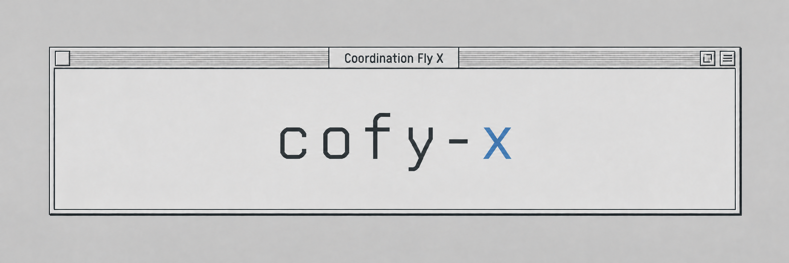

  <a href="https://github.com/cofy-x/.github/blob/main/profile/README.md">English</a>

  

  <strong>为人与 AI Agent 协作构建开源工具与基础设施。</strong>

cofy-x 构建让人与 AI Agent 一起工作的开源软件，涵盖共享工作区、实用工具，以及支撑它们的执行基础设施。

**cofy-x** 的全称是 **Coordination Fly X**：让人与 AI 协作，把想法转化为可以运行的开放系统。

## 我们探索的方向

- **工作区与协作：** 探索人与 Agent 共享上下文、共同创作与审核工作的方式。
- **执行基础设施：** 探索隔离执行、可复现环境与可靠的 Agent 运行基础。
- **工具与实验：** 打磨实用开发工具，探索交互、可视化与新的工作方式。

[浏览全部仓库 →](https://github.com/orgs/cofy-x/repositories?type=public)

## 参与方式

欢迎在各项目仓库中提问、交流想法或参与贡献。使用方式与贡献指南以对应项目的 README 为准。

请通过[安全报告入口](https://github.com/cofy-x/.github/security/advisories/new)私下报告漏洞。
